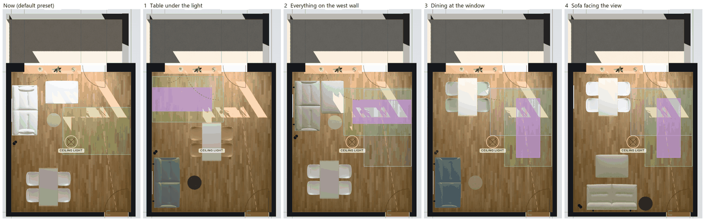
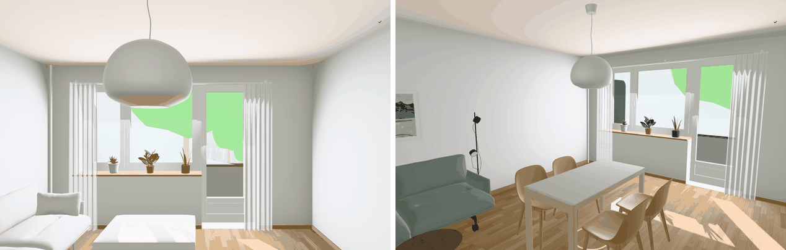

# Layout review: feng shui, interior design and yoga

A review of where the furniture stands in the living room, for a room that is also a yoga studio
almost every day, and four layouts to offer as presets. Every layout was placed in the planner
(through `roomApp.furniture`, with temporary presets that were not saved to the catalog), checked
for overlaps, door swings and clearances, and photographed in Plan, 3D and Walk. The layouts, in
the `presets.json` format, pass `scripts/check-catalog.mjs` when they are appended to the presets.



*Plan view, window wall at the top, entry door at the bottom right. Green: the practice zone; blue:
a second practice zone; purple: a 2.0 × 0.8 m mat; amber ring: the pendant's shade; dashed red: the
straight line from the entry door to the balcony door.*

## The room

- 4.04 × 4.75 m (19.2 m²), 2.50 m ceiling. All numbers come from `src/config.js` and the models'
  own boxes in the planner.
- In this document, *left* and *right* are as seen from the entry door, looking at the window.
  `config.js` calls them west and east, and `x` runs from the left wall, `z` from the window wall.
- **Window wall:** the window is 1.91 m wide, 0.44 m from the left corner, with its sill at
  0.84 m. Its wide sash opens inward over the sill and reaches about 0.95 m into the room. The
  balcony door (x 2.35–3.22) is hinged on the right and swings 0.76 m into the room. The curtain
  rail runs from x 0.37 to 3.40, with the sheers gathered at both ends.
- **Entry wall:** the door (x 3.15–3.94) is 10 cm from the right wall. It swings in toward the
  right wall, through x 3.15–3.94 and z 3.96–4.75. Beside it, at x ≈ 2.98, is a switch plate with a
  socket at 1.34 m; a plug is in it in the photos.
- **Pendant:** an opal globe 44 cm across at the room centre (x 2.02, z 2.37), its bottom 1.68 m
  above the floor. It looks like a Muuto Fluid pendant, large.
- **No radiator** shows in any photo, and the wall under the window is plain, so the flat probably
  has underfloor heating. That's worth checking before putting a mat or rug over a heating loop.
  The switch plate is the only socket the photos show, so a floor lamp by the sofa needs a socket
  near it; check the baseboards along the left wall.
- **What is in the room today** (photos): a large grey corner sofa with a chaise on the left wall,
  nesting oak coffee tables with pointed ends, the dining set at the entry end, and the yoga props
  in the window-right corner on a black metal shelf (mats, bolsters, blankets, blocks, a wooden box),
  with folding yoga chairs leaning on the right wall. The props look like those of an Iyengar
  practice, which uses a wall a lot.

### The real compass

`site.facade.bearing` is 209.15°, and `surroundings.direction()` turns compass bearings into room
coordinates. In the running app, `direction(209, 0)` is `(0, 0, −1)`, straight out through the window
wall, and north is `(0.49, 0, 0.87)`. So:

| Wall | `config.js` label | Faces (outward normal) | Lies on the room's … side |
|---|---|---|---|
| Window wall | north | 209° SSW | SSW |
| Entry wall | south | 29° NNE | NNE |
| Left wall | west | 119° ESE | ESE |
| Right wall | east | 299° WNW | WNW |

The `config.js` names are only labels, and they are off by about 150–180°: the "west" wall is the
room's sunrise side. Below, *left* and *right* are used, and compass bearings only where they matter.

### Daylight and sun

Both the app's sun model (`sun.js` with the swisstopo neighbourhood) and a ray count over the
floor agree. The count used a 20 cm grid on the 21st of each month: through the panes, under the
balcony above, over the parapet, past the screen and the neighbours' buildings and trees.

- **No direct sun before about 10:00 in any month.** The window faces SSW, so the sun stays behind
  the facade until it passes about 119°. Mornings are soft, even and glare-free.
- **June to August: almost no direct sun on the floor.** The balcony above (2.55 m high, 1.65 m deep)
  cuts off the high sun. The low evening sun from the WNW, which could come in under the balcony
  from the side, is blocked by the trees and buildings in the model.
- **September to March:** small, brief patches between about 11:00 and 14:00. Late morning they fall
  in the right third, by the balcony door, then they move toward the window and left. For example,
  21 October 13:00 gives about 1.8 m² (x 1.7–3.9, z 0.3–1.7); 21 December 12:00–13:00 about
  0.5 m²; 21 March 14:00 about 0.4 m². Without the neighbourhood, the geometry alone would let in
  up to 5 m² on a December afternoon, reaching the entry wall. The model's trees are solid crowns;
  real trees without leaves let more winter sun through, so winter afternoons will be somewhat
  sunnier than the model shows.
- So it is a calm, indirect-light room. The brightest floor is the band within about 1.7 m of the
  window, and glare is a small problem for every seat. A sofa that faces the window still looks
  into a bright sky all day, which matters for screens.

## Findings

### Feng shui

1. **Commanding position.** The best seat in this room has its back to the left wall in the
   entry half: from there the door is about 3 m ahead and a little to the right, in plain view,
   and not in line with it. Today's sofa (left wall, window end) is also good: a solid wall behind
   it, and the door on a diagonal. A sofa on the entry wall (sketch B) is the weakest: the door is at
   its right shoulder, about 1 m from the arm, so you hear people come in rather than see them.
2. **The path of chi.** Both doors sit on the right: the entry door 10 cm from the right wall, and
   the balcony door at the right end of the window wall. The straight line between them is 4.8 m
   long and runs down the right third of the room. Chi (and people) rush along it, so nothing
   should block it, and neither a seat nor a mat should sit in it for long. That makes the right
   side the room's spine and the left side the place for furniture, and it makes the right wall the
   natural wall to keep free. A practice strip along the right wall, though, lies in that line.
3. **Seating at the window.** None of the layouts puts a seat with its back to the glass. Today's
   pouf stands in front of the window, low and backless. That's acceptable, but it takes the
   brightest floor in the room.
4. **Sharp corners.** The current nesting coffee tables have pointed ends aimed at the sofa. The
   Soft Side Table is round, which solves that. The Workshop table's square corners are the
   remaining "arrows"; in layout 1 one of them is 0.8 m from the sofa's window-end seat, and it
   matters little at that distance.
5. **Five elements.** The room is heavy in Wood (oak parquet, oak legs and tops, the plants) and in
   Metal (white walls, white sheers, the opal globe). Fire comes in with the SSW light, Earth is
   moderate, and Water is the weakest (only the black frame of the old poster). The finishes below
   add Earth and sand tones in the bright window half, green or blue in the left (Wood) half, black
   accents near the door (Water, on the north side), and keep the free wall white and empty (Metal).
6. **Bagua, compass school, from the room's centre with the real bearings.** The room is turned
   about 29° from the compass, so the window-right and entry-left corners sit near sector borders.

   ```
                         window wall (faces SSW)
          +------------------+------------------+------------------+
          | S  fame          | SW relationships | W  children,     |
          |    Fire          |    Earth         |    creativity    |
          |                  |                  |    Metal         |
   left   +------------------+------------------+------------------+  right
   wall   | SE wealth        | centre           | NW helpful       |  wall
   (ESE)  |    Wood          |    Earth         |    people, Metal |  (WNW)
          +------------------+------------------+------------------+
          | E  family,       | NE knowledge,    | N  career        |
          |    health, Wood  |    self-         |    Water         |
          |                  |    cultivation   |    (entry door)  |
          +------------------+------------------+------------------+
                         entry wall                     [door]
   ```

   The entry door is in the north sector (career, Water): keep it open and uncluttered, with a dark
   accent nearby. The centre is Earth, the classic place for the table that feeds the household.
   Knowledge and self-cultivation (NE) is the middle of the entry wall: a good home for the yoga
   props and books. The window half (S fame / SW relationships) is the room's Fire side, bright and
   active. Family and health (E) is the left wall's entry end: a green or wooden sofa there
   supports it.
   The door-aligned (BTB) bagua gives nearly the same map: wealth in the window-left corner,
   relationships at the balcony door, helpful people by the entry door.

### Interior design

1. **The pendant hangs at head height over open floor.** Its bottom is 1.68 m above the floor at
   the room's centre, so anyone taller than 1.68 m walks into it. In the current layout and in
   sketch B it hangs over the route from the door to the sofa and window, and over the middle of
   the free floor where a mat across the room would go: arms raised overhead reach about
   2.1–2.2 m. There are two fixes: a table under it (layout 1), or a shade lifted to at least
   2.05 m (about 40 cm shorter cable) or swagged over the table on a ceiling hook. Over a table it
   should hang lower: its bottom at about 1.40–1.45 m, 67–72 cm above the 73 cm top.

   

2. **Circulation.** Every layout keeps an unbroken path of at least 0.97 m along the right side
   from the entry door to the balcony door, with chairs pulled out; with chairs tucked it is
   1.27 m or more. The door swing and the balcony-door swing are clear in all of them.
3. **Dining clearances.** A seated diner needs at least 0.75–0.80 m from the table edge to a wall
   or obstacle behind them, and 0.9 m if someone must pass. Today the table is 0.93 m from the left
   wall: enough to sit, too little to pass behind. At the window (layouts 3 and 4) it is
   0.85 m. Under the pendant (layout 1), every chair has 0.77–0.97 m behind it when pulled out.
4. **Conversation.** Comfortable seating distance is about 1.2–3 m. In layouts 1 to 3 the dining
   chairs turn toward the sofa within that range. In layout 4 every seat faces the window, like a
   row in a cinema.
5. **Scale.** For a 19 m² room that is cleared for yoga most days, the Outline 2-seater
   (1.70 × 0.88 m; 0.93 m deep on castors) is the right size. The In Situ with its chaise (2.16 ×
   1.63 m) covers 3.5 m², a fifth of the floor. It only fits layout 2, and leaves 9 cm between its
   chaise and the practice zone. By the footprints, the Outline 3-seater (2.20 m) would fit
   layouts 2–4 with small shifts, but not layout 1, where its window-end seat would face a dining
   chair 0.3 m away. That wasn't checked in the planner.
6. **Views.** The view is greenery: trees, and the plants on the balcony and the sill. It belongs to
   whoever faces the window: the sofa in layout 4, the dining table in layouts 3 and 4, and the
   practitioner in the strips facing the window.

### Yoga

**The practice zone assumed throughout:**
- a 2.0 × 0.8 m mat;
- 2.6 × 1.6 m of clear floor around a free-standing mat: 40 cm along each long side, 30 cm at each
  end;
- or 2.3 × 1.6 m with one short end of the mat against a wall, for inversions and wall work;
- for standing poses with the back to the wall, the mat along the wall, about 1.0 × 2.6 m;
- nothing hanging below about 2.2 m over the zone;
- one wall left free for at least 1.6 m behind the mat's end. Iyengar practice uses the wall for
  headstand and handstand, legs up the wall, and wall ropes if they are fitted.

Today the free floor is the right half of the room. A mat along the right wall, facing the window,
fits there (1.6 × 2.6 m), but it lies in the door-to-balcony line and blocks the balcony during
practice. A mat across the room, the other natural spot, would be under the pendant. The shelf and
the folding chairs on the right wall have to move if that wall is to stay completely free. Each
layout below gives the zone, which way the practitioner faces, what moves, and where the props go.

On orientation: a practitioner facing the left wall faces ESE, toward the sunrise, which is the
direction Vastu favours (east or north) for practice. Facing the window means SSW: the daylight and the view, but the
brightest sky in your eyes.

## The layouts, ranked

How to read the plans: one character is 10 cm across and one row 25 cm deep. The top edge is the
window wall: `=` is the window and `"` the balcony door. The gap in the bottom edge is the entry
door. `S` sofa, `P` pouf, `o` side table, `T` table, `c` chair, `L` floor lamp, `#` mat, `.`
practice zone, `*` pendant.

| Rank | Layout | Free wall | Practice zone | Out of the door line | Pendant | Sofa sees the door |
|---|---|---|---|---|---|---|
| 1 | Table under the light | right, all of it (plus the left wall's window half) | 2.40 × 1.55 m by the window, head on the left wall | yes | over the table | yes, straight ahead |
| 2 | Everything on the left wall (A improved) | right, 3.96 m | 2.30 × 1.60 m across, or 1.60 × 2.60 m along the right wall | no | raise it | yes, diagonal |
| 3 | Dining at the window, sofa facing the door | right | 1.60 × 2.60 m along the right wall; 2.10 × 1.60 m across | no | raise or swag | yes, straight ahead |
| 4 | Sofa facing the view (B improved) | right | as 3 | no | raise or swag | at its shoulder |

### 1. Table under the light (recommended)

```
+----===================-""""""""--------+
|                                        |
|........................                |
|####################....                |
|####################....                |
|####################....                |
|........................                |
|........................                |
|             cccccTTTTcccccc            |
|             cccccTTTTcccccc            |
|                 TTT*TT                 |
|             cccccTTTTcccccc            |
|             cccccTTTTcccccc            |
|SSSSSSSSSS                              |
|SSSSSSSSSS                              |
|SSSSSSSSSS  ooooo                       |
|SSSSSSSSSS  ooooo                       |
|SSSSSSSSSS                              |
|SSSSSSSSSS                              |
|                                        |
+-------------------------------        -+
```

The Workshop table stands under the pendant, long side along the room. The sofa backs onto the
left wall at the entry end. The window end is the practice room.

| Piece | `place` | Footprint x · z (m) | Finish |
|---|---|---|---|
| Sofa: Outline 2-seater | `{left: 0.02, door: 0.15, rotation: 90}` | 0.02–0.95 · 2.90–4.60 | Steelcut 160 (sage), Castors, Black |
| Pouf | `present: false` | – | |
| Side table: Soft Side Table | `{left: 1.2, door: 0.76, rotation: 0}` | 1.20–1.68 · 3.51–3.99 | Ø 48 × 40, Solid Smoked Oak top, Black base |
| Dining table: Workshop 130 × 65 | `{x: 2.02, z: 2.37, rotation: 90}` | 1.70–2.35 · 1.72–3.02 | Warm Grey Linoleum / Oak |
| Chairs 1–4: Fiber Side Chair | `{x: 1.53, z: 2.09, rotation: 90}`, `{x: 1.53, z: 2.65, rotation: 90}`, `{x: 2.51, z: 2.09, rotation: 270}`, `{x: 2.51, z: 2.65, rotation: 270}` | 1.27–1.79 and 2.25–2.77 · 1.85–2.89 | Ochre shell, Oak base, Felt glides |
| Floor lamp: Post | `{left: 0.02, z: 2.72, rotation: 90}` | 0.02–0.20 · 2.64–2.80 | Black |
| Sofa picture (Hodler, Le Grammont) | `{left: 0.002, z: 3.75, y: 1.05, rotation: 90}` | over the sofa | |
| Table picture (Hodler, Mont Blanc) | `{x: 2.2, door: 0.002, y: 1.22, rotation: 180}` | over the prop sideboard | |

The table and chairs are placed by their centres (`x`/`z`), at the ceiling outlet in `config.js`
(x 2.02, z 2.37). If the room is re-measured and the outlet moves, these move with it by hand: the
planner can't place a piece relative to the pendant.

- **Free wall:** the right wall, all of it: it is the corridor, at least 1.27 m wide (0.97 m with
  someone seated on the right). The left wall is also free from the window to 2.65 m: that is the
  yoga wall.
- **Practice zone:** x 0.02–2.42, z 0.15–1.70 (2.40 × 1.55 m), with the mat across the room, its
  head on the left wall (x 0.02–2.02, z 0.53–1.33).
  - For inversions and legs up the wall, the practitioner faces the left wall: ESE, the sunrise
    side.
  - For standing poses with the back to the wall, the left wall from the window to 2.65 m has 1.27 m
    of floor in front of it, up to the dining chairs.
  - The window light comes from the side, with no glare. The pendant is 0.45 m outside the zone and
    over the table. The zone is about 3.3 m from the entry door, out of its line, and next to the
    balcony door for fresh air.
- **What moves for practice:** nothing; the chairs stay tucked in. For a second mat, use the right
  lane along the right wall.
- **Props:** a low sideboard on the entry wall between the sofa and the door, x ≈ 1.6–2.9 (for
  example the Enfold 124 × 45 × 63 cm), with the Mont Blanc print centred over it. That is the
  knowledge and self-cultivation sector, about 3 m from the mat. Mats stand upright in a basket
  beside it, and the folding chairs go in the 25 cm between it and the door frame, or in the hall.
- **Feng shui:**
  - The sofa takes the commanding seat: a solid wall behind it, the door straight across, not in
    its line.
  - The table fills the Earth centre, and the door-to-balcony line stays open.
  - Practice happens in the bright Fire half of the room, away from the door.
  - The sage sofa (Wood) sits in the family and health sector.
  - The ochre shells, the warm-grey linoleum and the oak add Earth around the centre; the black
    castors, base and lamp add Water.
- **Design:**
  - The pendant finally lights a table, so nobody walks under it.
  - Every chair has room behind it.
  - The sofa, the side table and the dining chairs form a loose group 1.5–2.5 m apart, for
    conversation.
  - The sofa sits in the darkest part of the room, so it gets the floor lamp at its window-end arm.
- **Trade-offs:**
  - The middle of the room is furnished, so you see the table first from the door.
  - The zone is 2.40 m, not 2.60 m, long: the balcony door's swing stops it, and the far end runs
    out into the lane if you need more.
  - The sofa has the window only at an angle.
  - The In Situ does not fit here.
  - The table corner nearest the sofa's window-end seat is 0.8 m away.

### 2. Everything on the left wall (sketch A, improved)

```
+----===================-""""""""--------+
|                                        |
|SSSSSSSSSSPPPPPPP                       |
|SSSSSSSSSSPPPPPPP.......................|
|SSSSSSSSSSPPPPPPP.......................|
|SSSSSSSSSSPPPPPPP...####################|
|SSSSSSSSSSPPPPPPP...####################|
|SSSSSSSSSS  ooooo...####################|
|SSSSSSSSSS  ooooo.......................|
|LL               .......................|
|                    *                   |
|                                        |
|                                        |
|         TTTTTTT                        |
|     cccccTTTTTccccc                    |
|         TTTTTTT                        |
|     cccccTTTTTccccc                    |
|     cccccTTTTTccccc                    |
|                                        |
|                                        |
+-------------------------------        -+
```

Today's arrangement, made yoga-ready. The pouf leaves the window: on castors it stands lengthwise
against the sofa's window-end seat, making a chaise, so the floor in front of it is clear. The
table moves 25 cm off the entry wall to make room for a prop cabinet.

| Piece | `place` | Footprint x · z (m) | Finish |
|---|---|---|---|
| Sofa: Outline 2-seater | `{left: 0.02, window: 0.3, rotation: 90}` | 0.02–0.95 · 0.30–2.00 | Clay 12, Castors, Black |
| Pouf: Outline Pouf | `{left: 0.96, window: 0.3, rotation: 90}` | 0.96–1.74 · 0.30–1.41 | Clay 12, Base with Castors / Black |
| Side table: Soft Side Table | `{left: 1.2, window: 1.47, rotation: 0}` | 1.20–1.68 · 1.47–1.95 | Ø 48 × 40, Solid Oak top, Grey base |
| Dining table: Workshop 130 × 65 | `{left: 0.925, door: 0.45, rotation: 90}` | 0.93–1.57 · 3.00–4.30 | Warm Grey Linoleum / Oak |
| Chairs 1–4 | `{x: 0.76, z: 3.37, rotation: 90}`, `{x: 0.76, z: 3.93, rotation: 90}`, `{x: 1.74, z: 3.37, rotation: 270}`, `{x: 1.74, z: 3.93, rotation: 270}` | 0.50–1.02 and 1.48–2.00 · 3.13–4.17 | Natural White shell, Oak base, Felt glides |
| Floor lamp: Post | `{left: 0.02, z: 2.2, rotation: 90}` | 0.02–0.20 · 2.12–2.28 | Black |
| Sofa picture | `{left: 0.002, z: 1.15, y: 1.05, rotation: 90}` | over the sofa | |
| Table picture | `{x: 1.25, door: 0.002, y: 1.22, rotation: 180}` | over the table, as now | |

- **Free wall:** the right wall, from the window to the door swing (3.96 m). Everything else
  stands on the left wall, so this is the "one long wall" layout.
- **Practice zones:**
  - Across the room, head on the right wall: x 1.74–4.04, z 0.55–2.15 (2.30 × 1.60 m), mat at
    x 2.04–4.04, z 0.95–1.75. Inversions with the back to the wall face ESE.
  - Along the right wall, facing the window: x 2.42–4.02, z 0.60–3.20 (1.60 × 2.60 m), for
    standing poses with the back to the wall.
- **What moves:** nothing. The pouf is already parked as the chaise.
- **Props:** a cabinet on the entry wall between the table and the door, x 2.05–3.05 (for example the
  Enfold 100 × 45 × 85 cm, under the light switch). With the table 0.45 m off the wall, chair 4
  pulled out clears it by 11 cm.
- **Feng shui:**
  - The commanding seat of sketch A stays: a solid wall behind, the door on the diagonal.
  - Practice, however, takes place in the door-to-balcony line, and the balcony is closed while
    you practise.
  - Dining near the door is practical for carrying food in from the hall. In feng shui it is
    weaker, with food "leaving" through the door.
- **Design:**
  - The smallest change from today.
  - The sofa keeps the brightest corner for reading.
  - The lane is 1.74 m wide or more.
  - But the pendant still hangs over the walk from the door to the sofa and touches the edge of the
    zone across the room. Lift it to at least 2.05 m, or replace it with a flush ceiling light and
    give the table its own pendant on a swag hook.
- **Trade-offs:**
  - It keeps the door-line practice and the pendant problem.
  - The left-hand chairs have room to sit but not to pass behind.
  - The In Situ fits here (chaise to x 1.65), but leaves only 9 cm before the practice zone. The
    side table and the lamp then move to its door-end arm (not checked in the planner).

### 3. Dining at the window, sofa facing the door

```
+----===================-""""""""--------+
|                                        |
|    cccccTTTTTccccc                     |
|    cccccTTTTTccccc     ................|
|        TTTTTTT         ................|
|    cccccTTTTTccccc     ....########....|
|        TTTTTTT         ....########....|
|                        ....########....|
|                        ....########....|
|                        ....########....|
|                    *   ....########....|
|                        ....########....|
|                        ....########....|
|SSSSSSSSSS              ................|
|SSSSSSSSSS                              |
|SSSSSSSSSS  ooooo                       |
|SSSSSSSSSS  ooooo                       |
|SSSSSSSSSS                              |
|SSSSSSSSSS                              |
|                                        |
+-------------------------------        -+
```

Sketch B's best idea, the table at the window, combined with layout 1's sofa.

| Piece | `place` | Footprint x · z (m) | Finish |
|---|---|---|---|
| Sofa: Outline 2-seater | `{left: 0.02, door: 0.15, rotation: 90}` | 0.02–0.95 · 2.90–4.60 | Ecriture 760 (dusty blue), Castors, Black |
| Pouf | `present: false` | – | |
| Side table | `{left: 1.2, door: 0.76, rotation: 0}` | 1.20–1.68 · 3.51–3.99 | Ø 48 × 40, Solid Oak top, Beige Green base |
| Dining table | `{left: 0.85, window: 0.2, rotation: 90}` | 0.85–1.50 · 0.20–1.50 | Warm Grey Linoleum / Oak |
| Chairs 1–4 | `{x: 0.685, z: 0.57, rotation: 90}`, `{x: 0.685, z: 1.13, rotation: 90}`, `{x: 1.665, z: 0.57, rotation: 270}`, `{x: 1.665, z: 1.13, rotation: 270}` | 0.42–0.95 and 1.40–1.93 · 0.33–1.37 | Dusty Green shell, Oak base, Felt glides |
| Floor lamp: Post | `{left: 0.02, z: 2.72, rotation: 90}` | 0.02–0.20 · 2.64–2.80 | Brown Green |
| Sofa picture | `{left: 0.002, z: 3.75, y: 1.05, rotation: 90}` | over the sofa | |
| Table picture | `{left: 0.002, z: 0.85, y: 1.22, rotation: 90}` | on the left wall, over the table | |

- **Free wall:** the right wall, from the window to the door swing.
- **Practice zones:**
  - Along the right wall, facing the window: x 2.42–4.02, z 0.60–3.20, the mat at x 2.82–3.62,
    z 0.90–2.90.
  - Inversions across at the window end, head on the right wall: x 1.94–4.04, z 0.55–2.15. That is
    2.10 m, so keep the right-hand chairs tucked in.
- **What moves:** nothing.
- **Props:** the entry wall between the sofa and the door, as in layout 1.
- **Feng shui:**
  - The commanding sofa.
  - The table in the sunny Fire and Wood half, with the plants and the view.
  - The dusty-blue sofa (Water feeding Wood) in the family sector.
  - Practice is again in the door-to-balcony line.
- **Design:**
  - Meals in daylight.
  - The centre stays open.
  - The left-hand chairs have 0.85 m from the table edge to the wall: enough to sit, nobody passes
    behind.
  - The pendant hangs 1.8 m from the table, over open floor: lift it, or swag it to the table.
- **Trade-offs:**
  - The practice strip is in the traffic line.
  - The inversion zone is short.
  - The dining chairs nearest the window catch the midday patches from September to March.

### 4. Sofa facing the view (sketch B, improved)

```
+----===================-""""""""--------+
|                                        |
|    cccccTTTTTccccc                     |
|    cccccTTTTTccccc     ................|
|        TTTTTTT         ................|
|    cccccTTTTTccccc     ....########....|
|        TTTTTTT         ....########....|
|                        ....########....|
|                        ....########....|
|                        ....########....|
|                    *   ....########....|
|                        ....########....|
|        PPPPPPPPPPP     ....########....|
|        PPPPPPPPPPP     ................|
|        PPPPPPPPPPP                     |
|                                        |
|     SSSSSSSSSSSSSSSSS                  |
|     SSSSSSSSSSSSSSSSS                  |
|     SSSSSSSSSSSSSSSSS                  |
|     SSSSSSSSSSSSSSSSSooooo             |
| LL  SSSSSSSSSSSSSSSSSooooo             |
+-------------------------------        -+
```

Sketch B with its rough edges taken off:
- The sofa is centred on the window, not pushed into the corner.
- A 48 cm-high side table at the arm by the door acts as a buffer between the sofa and the door.
- The pouf on castors serves as a footstool that rolls away.
- The floor lamp stands in the corner the sofa leaves free.

| Piece | `place` | Footprint x · z (m) | Finish |
|---|---|---|---|
| Sofa: Outline 2-seater | `{left: 0.45, door: 0.02, rotation: 180}` | 0.45–2.15 · 3.80–4.73 | Ecriture 210 (sand), Castors, Black |
| Pouf: Outline Pouf | `{left: 0.75, door: 1.17, rotation: 0}` | 0.75–1.86 · 2.80–3.58 | Ecriture 210, Base with Castors / Black |
| Side table | `{left: 2.2, door: 0.05, rotation: 0}` | 2.20–2.68 · 4.22–4.70 | Ø 48 × 48, Solid Smoked Oak top, Black base |
| Dining table | `{left: 0.85, window: 0.2, rotation: 90}` | 0.85–1.50 · 0.20–1.50 | Warm Grey Linoleum / Oak |
| Chairs 1–4 | as layout 3 | 0.42–0.95 and 1.40–1.93 · 0.33–1.37 | Natural White shell, Oak base, Felt glides |
| Floor lamp: Post | `{left: 0.15, door: 0.1, rotation: 180}` | 0.15–0.30 · 4.47–4.65 | Black |
| Sofa picture | `{left: 0.002, z: 0.85, y: 1.05, rotation: 90}` | on the left wall, over the table | |
| Table picture | `{x: 1.3, door: 0.002, y: 1.22, rotation: 180}` | on the entry wall, over the sofa | |

- **Free wall:** the right wall.
- **Practice zones:** as layout 3.
- **What moves:** nothing for the strip. For more floor, roll the pouf against the sofa.
- **Props:** a low cabinet on the left wall between the table and the pouf, z ≈ 1.55–2.80 (for
  example the Enfold 124 × 45 × 63 cm).
- **Feng shui:**
  - The view and the light are the reward.
  - But the sofa has its back to the door wall, with the door at its right shoulder, in the career
    sector, so it is the weakest commanding position here. The side table softens it a little.
  - Practice is in the door-to-balcony line.
- **Design:**
  - The best view from the sofa.
  - But every seat faces the window, so it is poor for conversation.
  - On bright days you look into the sky, which is hard on screens.
  - The pendant hangs over open floor.
- **Trade-offs:** the weakest seat, practice in the door line, and the pendant, in exchange for the
  view.

### Layouts considered and dropped

- **The left wall free, everything on the right:** both doors are on the right, so furniture
  there would sit in the main path. A sofa on the right wall cannot see the door, which would be
  behind it.
- **Dining under the pendant with the table crosswise, or with the sofa on the entry wall:** the
  chairs would come within 0.5 m of the sofa, and there is then no 1.6 m-deep zone left anywhere.
- **The table pushed against the left wall (three chairs):** it frees 0.9 m more floor than
  layout 2. But in feng shui a table against a wall cuts off its chi, and the planner can't leave
  one of the chairs out (see below).

## Recommended preset combinations

| Preset id | Layout | Sofa | Pouf | Side table | Dining | Lamp | Prints |
|---|---|---|---|---|---|---|---|
| `layout-heart` | 1 | Outline 2-seater, Steelcut 160, castors | – | Ø 48 × 40, smoked oak / black | Warm grey linoleum; Ochre shells on oak, felt | Post, Black | Grammont over the sofa; Mont Blanc over the sideboard |
| `layout-one-wall` | 2 | Outline 2-seater, Clay 12, castors | Clay 12, castors, as a chaise | Ø 48 × 40, oak / grey | Natural White shells on oak, felt | Post, Black | as today |
| `layout-window-dining` | 3 | Outline 2-seater, Ecriture 760, castors | – | Ø 48 × 40, oak / beige green | Dusty Green shells on oak, felt | Post, Brown Green | Grammont over the sofa; Mont Blanc over the table, on the left wall |
| `layout-view-sofa` | 4 | Outline 2-seater, Ecriture 210, castors | Ecriture 210, castors, as a footstool | Ø 48 × 48, smoked oak / black | Natural White shells on oak, felt | Post, Black | Mont Blanc over the sofa; Grammont over the table |

Every choice is a real Muuto option from the product's `options.json`. Three of them serve the
movable-furniture brief:
- **Castors** (`base: "castors"`, Castors, Black, EUR 200) on the Outline sofa and the pouf, so both
  roll.
- **Felt glides** on the Fiber chairs (EUR 15), quieter and kinder to the lacquered oak when chairs
  slide in and out.
- **The 48 cm side table** (`48R2`) where it stands at a sofa arm rather than in front of the seat.

Alternatives within the same layouts:
- Layout 1 with Natural White shells, for a quieter room.
- Layout 2 with Steelcut 220 (the current default fabric), or with the In Situ in Clay 12 if the big
  chaise is wanted.
- Layout 3 with Fiord 951 or Instill 24, softer greens than the dusty blue.

### Products to evaluate (not in the planner)

All of these exist in Muuto's configurator (EU shop, checked 2026-10-26):
- **Prop storage:**
  - Enfold Sideboard: 100 × 45 × 85, 124 × 45 × 63, 148 × 45 × 85 or 186 × 45 × 48 cm. The 124 suits
    layouts 1, 3 and 4; the 100 suits layout 2.
  - Reflect Sideboard (small or large).
  - Mini Stacked Storage System (small, medium and large modules).
- **A smaller table**, if four places are rarely needed: Base Table 80 × 80 cm. The round Midst
  Table starts at Ø 120 cm, too big for layout 1.
- **Lighting:** the Fluid Pendant Lamp (large), if the existing pendant is replaced. The Post Floor
  Lamp is already in the planner.
- **A rug** for the lounge only, never under the mat: Ply Rug, 240 × 170 cm. In layout 1 it would go
  between the sofa and the sideboard.

## The art prints and the floor lamp

`presets.json` now has two prints and a floor lamp:
- `sofa-picture`: Hodler's *Le Grammont après la pluie*, 60 × 80 cm, a frame 0.83 m wide. It hangs on
  the left wall at z 1.0–1.3 (by preset), its bottom at 1.05 m, over today's sofa.
- `table-picture`: Hodler's *Le Mont Blanc aux nuages roses*, 50 × 70 cm. It hangs on the entry wall
  at x 1.25, its bottom at 1.22 m, over today's table.
- `floor-lamp`: the Post Floor Lamp, by the left wall at z 2.1–2.5.

None of them is on the right wall, so nothing conflicts with the free wall in any layout.

One conflict to avoid: in layouts 1 and 3 the sofa moves to the entry end. If the sofa picture
stayed at z 1.3, it would hang over the mat's head end on the yoga wall (the mat covers z 0.53–1.33),
where feet and hands go in headstand and legs-up-the-wall. So every layout preset moves both prints
and the lamp to where that layout needs them (the tables above). The existing presets don't place
`table-picture`, so it goes back home when one of them is picked after a layout.

## What the preset system needs to offer layouts

Today a preset sets product, finish and place together, for every piece. To offer layouts as
options, and the areas the user wants (sofa, dining, light, storage), the planner needs the
following.

1. **Layout as its own choice, separate from finishes.** A layout is places (and which pieces
   are present). A look is products and finishes, grouped by area:
   - Sofa: sofa, pouf, side table.
   - Dining: table, chairs.
   - Light: floor lamp, and the pendant's height.
   - Storage: sideboard, shelves.
   - Art: prints.

   The panel would show a Layout row first, then one row per area. The room is then layout × looks,
   and the link could carry both: `#layout=heart&sofa=steelcut-160&dining=ochre`. The four presets
   here are written as full presets today, so they work with the current panel; splitting them is
   mechanical.
2. **Places that depend on the product.** A layout may not fit every product: the In Situ fits
   only layout 2. A layout needs a list of allowed products per piece, or a place per product. The
   panel should then grey out or fall back for combinations that don't fit.
3. **Places relative to pieces in more ways.** The castors model is 6 cm deeper than the standard
   sofa, so a pouf placed by wall distance in front of it overlaps when the base changes (layout 2
   uses `left: 0.96` for that reason). `attach` only knows "across the window end" and "in front of
   the door-end seat". It needs a side (front, along), a gap and a rotation, so the pouf can run
   lengthwise along the sofa. The pictures need the same ("over the sofa, 27 cm above its back"), so
   that they follow the sofa between layouts instead of each layout re-placing them.
4. **A current-preset check that compares places.** `currentPreset()` compares only products,
   presence and finishes. Two layouts with the same finishes would both show as current. Layouts
   need a place comparison, within a few centimetres.
5. **A practice mode.** Each layout could have a "Clear for yoga" state: what rolls where, if
   anything. A Settings overlay, like Show measurements, would draw the practice zone, the mat,
   the free wall and the door-to-balcony line (the overlays in these screenshots were drawn that
   way, in the page only).
6. **The pendant height per layout,** and optionally a swag point. `pendant.bottom` is a room
   constant in `config.js`. Layout 1 wants it about 25 cm lower over the table; the others want it
   about 40 cm higher.
7. **Storage and wall-hung pieces.** There are no storage products yet. Pictures already hang (`y`
   and the wall rules), so wall shelves could use the same mechanism. Simple boxes for the props
   (a mat roll, a bolster, folded chairs) would let a layout show where they go.
8. **Optional chairs, or a chair count.** Only `optional` pieces can be left out, so a
   three-chair table against the wall can't be expressed.
9. **A layout check in `npm test`:**
   - overlaps, as now;
   - door and balcony-door swings;
   - chairs pulled out 30 cm;
   - the lane from door to balcony door at least 0.9 m;
   - the practice zone clear;
   - nothing at head height (under 2.0 m) over a walkway.

   The script that checked the first five for this review is a few dozen lines over
   `furniture.footprint()`.

## How this was checked

- The planner ran at `npm start`, in headless Edge (SwiftShader, quality forced to High so the
  sun has shadow maps), at 1400 × 900.
- Each layout was applied as a temporary preset pushed into `roomApp.furniture.presets`. The
  footprints, overlaps, door swings, chairs pulled out 30 cm, the lane width and the zones were
  measured from `furniture.footprint()`.
- The only overlaps are the chairs tucked 10 cm under their own table, as in the current presets.
- The sun table comes from rays cast in the page against the panes, the balcony geometry and
  `surroundings.group`.
- The screenshots (Plan, 3D and Walk of the current layout and of each layout, a Walk view at the
  pendant, and the sun studies) are kept outside the repo. The two images in `docs/images/` are
  made from them.
